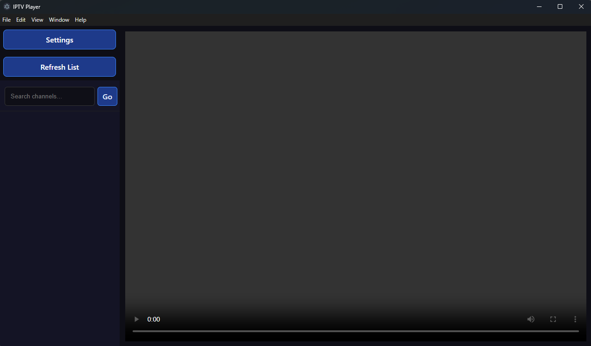

# A Very Simple IPTV Player

Kodi was irritating me so I am making a personal one to my liking :)

Playback reliability
--------------------
HLS streams use hls.js with a 30-second buffer target and bounded recovery.
A stream that stops progressing for 20 seconds is retried up to three times.
Manual pauses are respected. Buffering still depends on the source providing data.

Enable **Hide failed channels** to hide channels that have failed playback during
this session. Turn it off to retry a channel, or use **Reset failed channels**.
Successful playback clears that channel's failure. The playlist is never deleted
or permanently pruned, and there is no background scan of provider streams.

Run `npm test` for proxy lifecycle regression checks, `npm run build` for the
renderer, and `npm run dist` for Windows packages. Packages go into `release/`.
