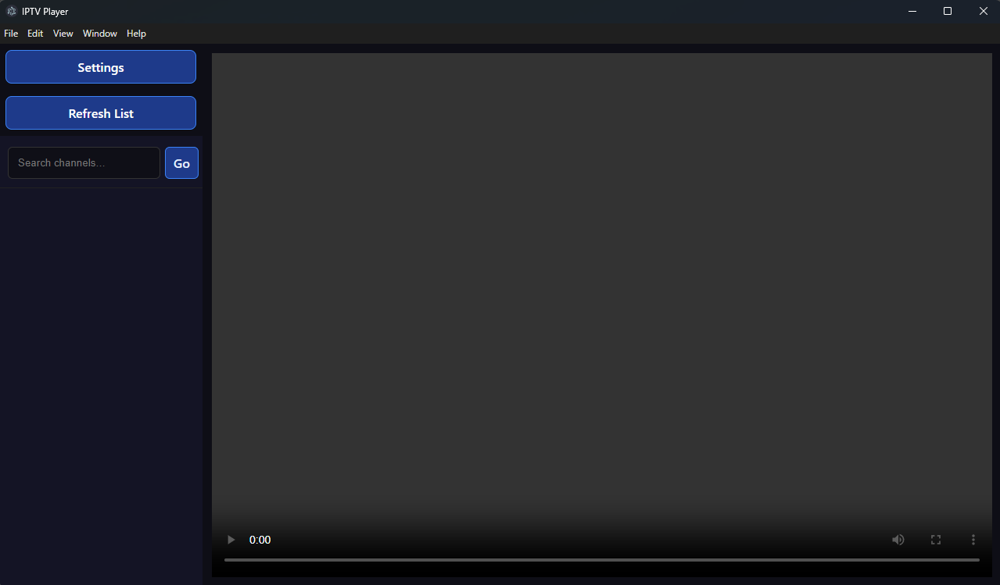

# A Very Simple IPTV Player

Kodi was irritating me so I am making a personal one to my liking :)

Playback reliability
--------------------
HLS streams use hls.js with a 30-second buffer target and bounded recovery.
A stream that stops progressing for 20 seconds is retried up to three times.
Manual pauses are respected. Buffering still depends on the source providing data.

Enable **Hide failed channels** to hide channels that have failed playback during
this session. Turn it off to retry a channel, or use **Reset failed channels**.
Successful playback clears that channel's failure. The playlist is never deleted
or permanently pruned, and there is no background scan of provider streams.

Run `npm test` for proxy lifecycle regression checks, `npm run build` for the
renderer, and `npm run dist` for Windows packages. Packages go into `release/`.

Personal library (1.1.0)
-----------------------
- Volume and mute are restored when switching channels or reopening the app.
- Star a channel and open Favorites to see saved favorites.
- Finite movies and episodes save progress every five seconds, on pause, and when
  leaving playback. Returning offers Resume or Start over when a saved position
  is available. Resume requires a source that supports seeking.
- History keeps up to 200 entries and shows the last watched episode per series.
  Series grouping recognizes names such as `Show S01E03` and `Show 1x03`.
- Live channels are excluded from resume history. Live recording/timeshift is not
  included. Streams routed through the FFmpeg live proxy do not support resume.

Library preferences are saved locally in the app's Electron browser profile.
Favorites use provider ID/name/group when available, otherwise the original URL.
History only shows items still present in the loaded playlist.

`npm run test:renderer` checks volume/mute, favorites, and episode resume in a
hidden Electron window with isolated test data and a generated local video.

Last channel (1.2.1)
--------------------
Use Last (or press L) to toggle between the two most recently opened streams.
It uses the original provider link, so converted streams get a fresh proxy.
Buffering the same channel does not overwrite the previous channel. The shortcut
also works while the video is fullscreen, and is ignored while typing in a
field, while Settings is open, or while a channel is loading. Last is kept for
the current app session and becomes available after switching channels.

Fire TV app
-----------
A separate native Fire TV preview lives in `firetv/`. See `firetv/README.md` for
features, build steps, limitations, and APK sideload instructions. The Windows
app and its saved settings are separate.

Desktop Last fix (1.2.2)
------------------------
Last now records original provider links when a channel is opened successfully,
independently of delayed or missing player `playing` events. Replaying the same
link does not overwrite the previous stream, and temporary proxy URLs are never
kept as navigation destinations. The renderer regression test covers delayed
playback notifications and proxy URLs that change on every channel switch.

Desktop series search and watched markers (1.3.0)
------------------------------------------------
Search a series name and press Enter or Go. Matching S01E02, S01, 1x02, or
Season 1 Episode 2 titles are organized into collapsible Season folders. Seasons
and episodes use numeric order (2 before 10); unrecognized results sort A–Z.
Search also matches dot/underscore-separated title words. Multiple series keep
separate labeled season folders. The list remains virtualized when expanded.

Episode rows now show a checked box for Watched and a half-circle for In progress.
Progress starts after five seconds of finite playback; the watched check is set
when playback finishes or reaches the existing near-completion threshold. Click
the checkbox to mark an item watched/unwatched manually, including older episodes
seen outside this app. A manual change is respected for the remainder of that
playback session. Rewatching does not remove an existing completed check.

Watched markers persist separately from the 200-entry resume history. Existing
saved completed/started entries seed the markers on first use of this version.
Markers are local to the desktop app; this change does not update the Fire TV
preview or synchronize libraries between devices.

Desktop 1.3.2 removes the subtitle toolbar, subtitle imports, and local AI translation.

Fire TV updates (1.1)
--------------------
Fire TV builds and download links are published automatically at
https://github.com/anthony-baker87/iptv-player/releases when changes are pushed to `main` and the Android tests/lint pass. A pull request runs checks but cannot access signing secrets or publish a release. Use the **Fire TV build and release** workflow's Run workflow button to publish the current main branch again without a code change.

The TV app checks on startup at most once every six hours. Select **Updates** beside Playlist and Refresh for an immediate check. It offers a download when a newer Fire TV release exists, verifies the download's SHA-256, package identity, version, and original signing certificate, and opens the Fire TV installer for your approval. On Fire OS 6, **Apps from Unknown Sources** may need to be enabled in Developer Options; later Fire OS versions grant installation access to IPTV Fire TV specifically. Updates preserve the app's playlist, favorites, and history. Initial installation of a version with the updater is required; old 1.0.x previews cannot check for updates themselves.

The APK and `firetv-update.json` manifest are attached to `firetv-v*` releases. Desktop releases are separate and ignored by the Fire TV updater. The workflow assigns a monotonically increasing Android version code and a unique version name for each run. No playlist links or provider credentials are bundled or sent to GitHub.

The signing key is **not in this public repository**. Its encrypted GitHub Actions secrets are `FIRETV_KEYSTORE_BASE64`, `FIRETV_STORE_PASSWORD`, `FIRETV_KEY_ALIAS`, and `FIRETV_KEY_PASSWORD`. The public certificate SHA-256 in `firetv/signing-certificate.sha256` lets CI reject a build signed with a different key. This retains the original personal preview signing identity; it is not a new Amazon Appstore signing identity. A Windows-user-encrypted backup of the original key was created outside the repo under `%LOCALAPPDATA%/IPTVDesktopBuild/signing-backup/firetv-original-key.dpapi`; the original key remains under `%USERPROFILE%/.android/debug.keystore`. The encrypted backup is tied to this Windows user and should not be treated as a portable recovery copy.

Local Android build: `./firetv/build.ps1` checks and builds a debug APK. `./firetv/build.ps1 -Release` builds a release signed with the original local key. Override `FIRETV_VERSION_CODE` and `FIRETV_VERSION_NAME` for manual versions; a device cannot install a lower version code over its current version. Normal updates should use the CI release workflow.
